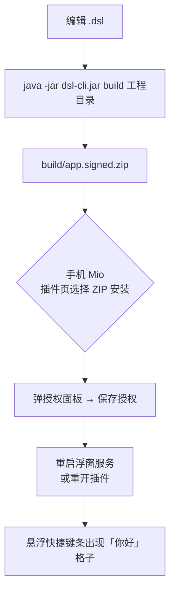

# 00 快速开始

**本章目标**：零基础（或让一个 AI）在 30 分钟内从空目录做出一个能跑的插件——含 1 个快捷键、1 个配置项、1 个 WS 服务声明——并理解全书的知识地图。

**前置**：会基本的 Java/JSON 阅读；电脑装了 Java 11+；手上有 Mio 宿主 APK。不需要会写过 DSL。

---

## 0.1 先建立三个概念

### ① Mio 是什么

Mio 是一个 Android 宿主应用。它把一批「宿主能力」（注入按键、弹悬浮窗、读传感器、开 WebSocket 服务……）以**宿主桥**的形式注册进一个 DSL 脚本引擎。**插件**就是一堆编译好的 `.dsl` 脚本 + 一个清单，被 Mio 加载后在引擎里运行，通过桥调用宿主能力。

```mermaid
flowchart LR
    A[你的插件<br/>.dsl 源码] -->|dsl-cli 编译| B[app.signed.zip]
    B -->|Mio 安装| C[DSL 引擎<br/>加载 AST]
    C -->|call("MioEngFun.tap")| D[宿主桥<br/>注入按键]
    C -->|call("Ws.sendCommand")| D2[宿主桥<br/>WS 服务]
    D --> E[游戏 / 系统]
```

### ② 两层命名（最容易迷路的地方）

同一件事在**宿主侧**和**插件侧**有两套名字：

| 层 | 名字长什么样 | 谁维护 | 例子 |
|---|---|---|---|
| 宿主桥（权威） | `命名空间.函数`，全小驼峰 | 宿主 `MioBridgeRegistry` 注册 | `MioEngFun.tap`、`Ws.sendCommand` |
| 插件侧包装 | 导出函数名，业务风格 | 插件工程里的 `.dsl` 包装文件 | `MioEngFun.tap(...)`、`MioWs.sendCommand(...)` |

包装文件里每一行都是这个形式（[03 §3.3](03-DSL语言快速上手.md) 有完整解释）：

```java
export fn Bool tap(String keyName, Int pressMs) = call("MioEngFun.tap")
//    └─ 插件侧名字 ─────────────────┘            └─ 宿主桥名字（权威）┘
```

**约定**：文档讲 API 时，签名以宿主桥为准（`09-附录` 有全量索引）；包装模块只是给你的业务代码一个好写的名字。**宿主桥里有的，包装一定能调；包装写错了，以宿主桥为准**。

### ③ 命名空间、服务、入口函数三层结构

- **命名空间**（宿主提供的能力集）：Mio 特有的共 7 个，见 0.5 节总表。
- **服务**（`config.json` 里的 `service`）：告诉宿主「这个插件有哪些模块要被特殊对待」——注册快捷键、提供配置页、接入 WS，各靠一个 tag。
- **入口函数**（`export` 的函数）：宿主在特定时机主动调用你的函数，如 `loading()`、`keyInit()`、`schema()`、`onPlayerChat()`；生命周期钩子 `onStart()` / `onEnable()` / `onDisable()` / `onUninstall()` 与 `checkUpdate()` 同理（全集见 [09 §C](09-附录.md)）。

---

## 0.2 环境准备（三件套）

| 件 | 是什么 | 拿到哪 |
|---|---|---|
| ① Mio 宿主 | 运行插件的 Android 应用 | 手机安装 Mio APK |
| ② dsl-cli | 编译打包工具（命令行） | `dsl-cli.jar`，本机任意目录 |
| ③ 插件工程骨架 | 目录结构 + 密钥 + 包装模块 | 复制参考工程 `Desktop\开发\Plugin`（结构见 [02 §2.1](02-插件包与运行环境.md)） |

验证环境：

```bash
java -jar dsl-cli.jar help        # 能列出子命令即就绪
```

> 没有参考工程也可以从零建目录，但**包装模块**（`src/script/mio/utils/*.dsl` 五个文件 + `mio/ws/MioWs.dsl`）建议直接复制——它们是 [04 模块 API 速查](04-模块API速查.md) 的插件侧签名，自己手写容易抄错。

---

## 0.3 最小插件工程（三合一示例）

目标产物目录（相对工程根）：

```
HelloMio/
├── build.config.json
├── keys/  (public_key.pem, private_key.pem)
├── res/
│   └── config.json          ← ① 清单：声明 4 个 service
└── src/script/
    ├── main.dsl             ← ② MAINSERVICE：宿主打开插件时调 loading()
    ├── config.dsl           ← ③ CONFIG：配置页 schema()
    ├── mio/
    │   ├── utils/…          ← ④ 包装模块（从参考工程复制）
    │   ├── shortcutKey/
    │   │   └── hello.dsl    ← ⑤ SHORTCUT_KEY：快捷键功能
    │   └── ws/
    │       └── helloWs.dsl  ← ⑥ WS_SERVICE：WS 入口
    └── …
```

### ① 清单 `res/config.json`

```json
{
  "plugin": {
    "permission": [
      { "name": "MODIFY_USER_UI", "desc": "修改用户界面布局和样式" }
    ],
    "service": [
      { "name": "main",                "tag": "MAINSERVICE"  },
      { "name": "config",              "tag": "CONFIG"       },
      { "name": "mio.shortcutKey.hello", "tag": "SHORTCUT_KEY" },
      { "name": "mio.ws.helloWs", "tag": "WS_SERVICE" }
    ]
  }
}
```

- `name` = 模块的**目录包路径 + "." + 文件名**（如 `mio/shortcutKey/hello.dsl` → `mio.shortcutKey.hello`）；`config` 是无包文件的叶名。文件里的 `package` 只写目录路径（不含文件名），必须与目录一致，否则 `dsl-cli` 报「package 与目录路径不符」。
- 4 种 tag 的完整语义见 [02 §2.2](02-插件包与运行环境.md)。

### ② `main.dsl`

```java
import dsl.System

export fn Void loading() {
    System.showToast("HelloMio 已加载")
}
```

### ③ `config.dsl`（配置页，一行一项）

```java
import mio.utils.MioConfig

export fn Void schema() {
    MioConfig.onSection("你好")
    MioConfig.onSwitch("hello.enabled", "启用问候提示", "关闭后点击快捷键不再弹提示", true)
    MioConfig.onText("hello.msg", "提示文字", "点快捷键时弹出的内容", "你好，Mio 插件！", "", "", 0, 0)
}

export fn Void onButton(String key) {
    return
}
```

> 保存时宿主直接把值写进 `HostData` 并重启插件；业务代码用 `HostData.get("hello.msg")` 读回。完整机制见 [11 配置页与HostData](11-配置页与HostData.md)。

### ⑤ `src/script/mio/shortcutKey/hello.dsl`（快捷键功能）

```java
package mio.shortcutKey        // = 文件所在目录路径（不含文件名）

import mio.utils.MioEngFun

private String HELLO_ID = "hello"

// 快捷键服务线程启动后的第一个回调：注册格子
export fn Void keyInit() {
    // 第 5 参 group = 面板分组标签（可省略）
    MioEngFun.onKeyInit("你好", "BUTTON", HELLO_ID, "点击后弹一个提示", "工具")
}

// BUTTON 按下期间进入；SWITCH 则是「开→进入、关→退出」
export fn Void onTriggerDown() {
    MioEngFun.showToast("你好，Mio 插件！")
}
```

### ⑥ `src/script/mio/ws/helloWs.dsl`（WS 服务入口）

```java
package mio.ws                 // = 文件所在目录路径（不含文件名）

// WS 服务启动时被调用一次；事件回调按 on<事件名>(String json) 导出
export fn Void serverInit() {
}
```

> 这是 WS 的最小骨架。29 种事件、23 个 `Ws.*` 桥、完整机器人示例见 [10 WS服务与游戏联动](10-WS服务与游戏联动.md)。

**命名规则（编译器强制校验）**：

- `package` 声明 **必须等于文件所在目录路径**（不含文件名）。`mio/ws/helloWs.dsl` → `package mio.ws`。不符会报 `package '…' 与目录路径不符`。
- `config.json` 服务的 `name` = **目录路径 + `/` 处写成 `.` + 文件名**。`mio/shortcutKey/hello.dsl` → `name: "mio.shortcutKey.hello"`。宿主按这个 `name` 找到模块并调用它的入口函数。

---

## 0.4 构建 → 安装 → 启用



逐条命令/动作：

```bash
java -jar dsl-cli.jar build ./HelloMio
# BUILD SUCCESSFUL … Output: build/app.signed.zip
```

1. 把 `build/app.signed.zip` 传到手机（数据线/任意传输方式）。
2. Mio 插件页面 → 选择该 ZIP → 安装（签名校验通过才装得上，见 [02 §2.5](02-插件包与运行环境.md)）。
3. 弹出授权面板 → 勾选需要的权限 → 「保存授权」。
4. 重启 Mio 悬浮窗服务（保证 `loadDslPlugins` 重新加载插件）。

> 改代码后重复 1~4 即可迭代；也可以把工程放设备 `/sdcard/程序/MioConfigs/Plugin/` 下直接在设备端控制台构建（[02 §2.4](02-插件包与运行环境.md)）。

---

## 0.5 验证清单

| # | 预期现象 | 看不到时查 |
|---|---|---|
| 1 | 安装成功、授权面板出现 | 签名是否用工程自带密钥重签过（[08](08-调试与错误处理.md)） |
| 2 | 插件打开时 toast「HelloMio 已加载」 | `main.dsl` 是否 `export fn Void loading()` |
| 3 | 悬浮快捷键条出现「你好」格子 | `config.json` 的 SHORTCUT_KEY `name` 是否等于「目录路径.文件名」（`mio.shortcutKey.hello`） |
| 4 | 点格子弹「你好，Mio 插件！」 | 按钮型入口是否为 `onTriggerDown`；注入未就绪会 toast 提示 |
| 5 | 插件配置页显示「启用问候提示」「提示文字」 | CONFIG 是否声明 `{"name":"config","tag":"CONFIG"}`；`schema()` 是否 `export` |
| 6 | 改配置保存后重开插件，值已生效 | 保存=自动重启插件（[11](11-配置页与HostData.md)） |
| 7 | WS 服务可启动 | 见 [10 章](10-WS服务与游戏联动.md) 的验证步骤 |

出错时：通知栏会直接弹 DSL 错误消息，对照 [08 调试与错误处理](08-调试与错误处理.md) 的错误码表。

---

## 0.6 知识地图（读完全书看这一张表）

### Mio 特有命名空间 × 7

| 命名空间 | 干什么 | 详细章节 |
|---|---|---|
| `MioEngFun` | 快捷键注册、按键注入、触发状态、提示 | [04 §1](04-模块API速查.md) |
| `MioGamepad` | 虚拟手柄摇杆/按键 | [04 §2](04-模块API速查.md) |
| `MioSensor` | 旋转传感器 pitch/yaw | [04 §3](04-模块API速查.md) |
| `MioFloating` | 悬浮窗/浮窗提示 | [04 §4](04-模块API速查.md) |
| `MioConfig` | 配置页声明（`schema()` 内调用） | [11](11-配置页与HostData.md) |
| `HostData` | 配置值持久化读写 | [11](11-配置页与HostData.md) |
| `Ws` | MC WebSocket 服务（23 桥） | [10](10-WS服务与游戏联动.md) |

### 清单服务 tag × 4

| tag | 模块要导出 | 一句话 |
|---|---|---|
| `MAINSERVICE` | `loading()` | 包级入口，打开插件时调 |
| `SHORTCUT_KEY` | `keyInit()` + `onTriggerDown()`… | 注册悬浮快捷键并跑触发循环 |
| `CONFIG` | `schema()`（+ 可选 `onButton`） | 提供配置页；**不声明=没有配置页** |
| `WS_SERVICE` | `serverInit()`（+ 可选 `on<事件>`、`onWsFeatureToggle`） | 接入宿主 WebSocket 服务 |

### 章节导航

| 想干什么 | 读 |
|---|---|
| 弄懂宿主如何加载插件 | [01 总览与原理](01-总览与原理.md) |
| 建工程/打包/装机 | [02 插件包与运行环境](02-插件包与运行环境.md) |
| 学 DSL 语法 | [03 DSL语言快速上手](03-DSL语言快速上手.md) |
| 查某个 API 怎么用 | [04 模块API速查](04-模块API速查.md) |
| 写快捷键逻辑 | [05 事件系统与触发模型](05-事件系统与触发模型.md) |
| 查按键名/组合键 | [06 注入与按键码](06-注入与按键码.md) |
| 看完整生产级示例 | [07 从零写示例](07-从零写示例.md) |
| 报错/排障 | [08 调试与错误处理](08-调试与错误处理.md) |
| 查全量索引/常量 | [09 附录](09-附录.md) |
| 做游戏联动机器人 | [10 WS服务与游戏联动](10-WS服务与游戏联动.md) |
| 做配置页 | [11 配置页与HostData](11-配置页与HostData.md) |

---

**下一步**：照 0.3 节把工程敲出来跑通；然后按 [README](README.md) 的顺序读书。
