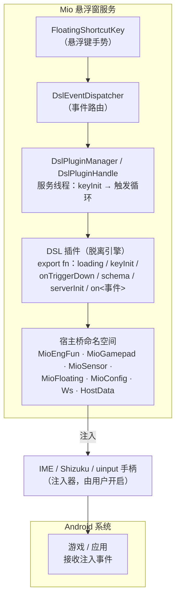

# 01 总览与原理

**本章目标**：搞清 Mio 的三件事——按键怎么被注入、DSL 插件在整条链路的哪个位置、插件从打开到关闭经历了什么。读完你就能回答「为什么 `onTriggerDown` 是阻塞的」「为什么配置保存后插件要重启」。

**前置**：无（本章是全书的总图）。

---

## 1.1 Mio 是什么

Mio 是一个运行在 Android 上的**按键映射/注入引擎**：它把用户输入的按键事件"接力"给游戏或应用，常见模式有「输入法注入、Shizuku 注入、虚拟手柄注入」三套通路。

DSL 插件负责的则是：**"什么时候注入、注入什么"**。编写一个 `.dsl` 脚本，注册快捷键，由快捷键的按下/松开/开关去驱动按键注入循环，实现自动攻击、蓄力连点、组合键宏等功能。插件还能再加两样能力：

- **配置页**：让用户在 UI 里调参数（间隔、按键、开关），落盘后插件读回（[11](11-配置页与HostData.md)）。
- **WS 服务**：与 MC 基岩版 WebSocket 联动，收游戏事件、回聊天/命令（[10](10-WS服务与游戏联动.md)）。

整体链路如下图所示：



---

## 1.2 注入原理

Mio 有三条注入通道，承载在 **iOS 之外的不变模型**上，DSL 里用 `MioEngFun` 的查询函数即可获知通道状态：

| 通道 | 就绪检测 | 说明 |
|---|---|---|
| 输入法注入（IME） | `isImeReady()` | 需启用并切换 Mio 内置输入法，注入全模拟 |
| Shizuku 注入 | `isShizukuReady()` / `isMapReady()` | 需 Shizuku 授权，注入后不可见原有输入法 |
| 虚拟手柄 | `isGamepadReady()` | 需开启虚拟手柄（uinput），注入游戏手柄事件 |

引擎综合就绪用 `isEngineReady()`（任一注入通道可用即真）。

> 注意：`isMapReady()` 当前语义等于 Shizuku 通道是否可用，历史命名，业务上建议用 `isShizukuReady()` + `getInputModel()`。

### 注入器怎么被选中

宿主决定「谁来做按键注入」的规则（`InputModelManager`）：

1. 读用户存储的模型配置（`APP_CONFIG_INPUT_MODEL`），缺省按 IME。
2. 若配置为 Shizuku 且 Shizuku 可用 → 走 Shizuku，否则回落 IME；**结果缓存 3 秒**。
3. 没有任何可用注入器时，动作类桥（`tap` 等）直接返回 `false`——**不抛错**。

细节见 [06 注入与按键码](06-注入与按键码.md)。

---

## 1.3 DSL 插件在链路中的位置

DSL 插件不直接碰 Android，它运行在 SDL 脚本引擎里，只能通过 Mio 暴露的**桥接函数**做事：

- 读状态：`isEngineReady` / `getInputModel` / `isTriggerDown` 等
- 做动作：`tap` / `tapGroup` / `tapCombo` / `keyDown` / `inputText` 等
- 控制手柄：`MioGamepad` 的摇杆、扳机、按钮
- 读姿态：`MioSensor` 的 pitch/roll/yaw
- 浮窗 UI：`MioFloating` 的 toast、准心、状态栏
- 配置页：`MioConfig.onSwitch/onText/…`（[11](11-配置页与HostData.md)）
- WS 联动：`Ws.sendChat/sendCommand/registerFeature/…`（[10](10-WS服务与游戏联动.md)）
- 读已保存配置：`call("HostData.get")`（[11 §11.6](11-配置页与HostData.md)）

桥接函数 = 宿主 Java 实现（`app/…/dsl/bridge/*.java`）。脚本里它们表现为 DSL 函数调用，例如 `MioEngFun.tap("KEYCODE_Q", 5)`。全量桥索引见 [09 附录 §D](09-附录.md)。

### 两层名字：宿主桥 vs 插件包装

| 层 | 例子 | 谁定义 | 写错会怎样 |
|---|---|---|---|
| 宿主桥（权威） | `MioEngFun.tap`、`Ws.sendCommand` | `MioBridgeRegistry.java` 注册 | `桥接函数未注册`（`BRIDGE_NOT_FOUND`） |
| 插件包装 | `mio/utils/MioEngFun.dsl`、`mio/ws/MioWs.dsl` 里的 `export fn` | 插件工程自带 | 你自己的文件，改名/加壳随意 |

包装的写法就是一行绑定：`export fn Bool tap(String k, Int ms) = call("MioEngFun.tap")`。业务代码调包装；包装缺函数时可以自己补一个 `= call("…")` 指向宿主桥。

---

## 1.4 插件生命周期

```mermaid
sequenceDiagram
    participant U as 用户/Mio
    participant M as DslPluginManager
    participant H as DslPluginHandle（服务线程）
    participant P as DSL 插件
    U->>M: loadDslPlugins()（悬浮窗服务启动 / 重装后）
    M->>M: 打开所有已安装插件包（open）
    M->>P: MAINSERVICE → loading()（一次）
    loop 每个 SHORTCUT_KEY service
        M->>H: 启动服务线程 dsl-service-&lt;包名&gt;.&lt;服务名&gt;
        H->>P: keyInit()（注册 onKeyInit 快捷键）
        loop 主循环（每 10ms 扫一次触发状态）
            H->>P: onButtonPress/onSwitchOn/… → onTriggerDown()（阻塞）
            H->>P: 确认松开后：onTriggerUp + 模型专属松开
        end
    end
    loop 每个 WS_SERVICE service
        M->>H: 启动服务线程
        H->>P: serverInit()（注册 WS 功能）
        H->>P: on<事件名>(json) / onWsFeatureToggle(key, enabled)（每 500ms 取一件任务）
    end
    M->>P: onStart()（该包服务全部启动后，可选）
    U->>M: 插件页启用开关（悬浮窗运行中）
    M->>H: 重载（close → open + 启动服务）
    M->>P: onEnable()（可选）
    U->>M: 插件页禁用 / 删除 / 关闭插件
    M->>P: onDisable() / onUninstall()（可选，句柄关闭前）
    M->>H: 置 closed → 中断线程 → 释放引擎句柄
```

要点：

- **`loading()`**：包内 `MAINSERVICE` 的入口，Mio 打开插件后调用一次，一般留空或做包级初始化。
- **`keyInit()`**：`SHORTCUT_KEY` 服务线程启动后第一个调用，负责用它往 Mio 注册快捷键（`MioEngFun.onKeyInit`）。
- **生命周期钩子** `onStart` / `onEnable` / `onDisable` / `onUninstall` 与 `checkUpdate`：全集与触发条件见 [09 附录](09-附录.md) §C-5，均为可选导出（`callIfExported`，未导出静默跳过）。
- **触发入口**见 [05 事件系统与触发模型](05-事件系统与触发模型.md)；**WS 入口**见 [10](10-WS服务与游戏联动.md)；**配置入口**（`schema`/`onButton`）见 [11](11-配置页与HostData.md)。

### 服务线程：插件函数跑在哪

宿主为每个服务开一条线程（`DslPluginHandle.ServiceThread`，线程名 `dsl-service-<包名>.<服务名>`，源码 `DslPluginHandle.java:440`），**两种循环按 tag 分流**：

| 服务 tag | 线程主循环 | 节奏 |
|---|---|---|
| `SHORTCUT_KEY` | 扫 `triggerStates` → 按模型调事件 → `Thread.sleep(10)` | 10ms 轮询（`DslPluginHandle.java:612`） |
| `WS_SERVICE` | `wsTasks.poll(500ms)` 取事件/开关任务执行 | 500ms 阻塞取（`DslPluginHandle.java:521`） |

推论（写代码必须知道）：

1. **同一线程串行**：一个服务内所有入口顺序执行，无并发访问解释器的问题——但也意味着 `onTriggerDown` 卡住 = 该服务后续 WS 事件/触发全排队。
2. **可以阻塞**：`sleep`/`tap`/`while` 循环都在这条线程上真阻塞，不会卡 UI；但要有退出条件。
3. **归属路由**：宿主按 `onKeyInit` 时 ThreadLocal 捕获的 owner 把触发事件只发给拥有该 id 的服务（`DslPluginHandle.java:566-574`），多服务不会串扰；归属未知时回退广播。
4. **`SdlException` 在循环里被捕获** → 日志 + 通知栏，**线程不死**，继续下一轮（`DslPluginHandle.java:616-620`）。

---

## 1.5 插件能看到什么（名字空间视图）

插件通过 `import` 引入其他模块后即可调用：

- **Mio 提供的六个命名空间**：`MioEngFun` / `MioGamepad` / `MioSensor` / `MioFloating` / `MioConfig` / `Ws`（签名见 [04 模块 API 速查](04-模块API速查.md)，配置与 WS 详解见 [11](11-配置页与HostData.md)、[10](10-WS服务与游戏联动.md)）
- 读配置的宿主调用：`call("HostData.get")`（[11 §11.6](11-配置页与HostData.md)）
- 引擎内置命名空间：`System`、`String`、`List`、`Map`、`Json`、`Math`、`Device`、`Http`、`Permission` 等（见 [03 DSL 语言快速上手](03-DSL语言快速上手.md) §3.8）

脚本**只能调用**这些名字空间里声明过的函数；直接调用未声明的宿主函数会报 `宿主可调用函数不存在`（详见 [08 调试与错误处理](08-调试与错误处理.md)）。

---

## 1.6 三个能力的启用前提

| 能力 | `res/config.json` 要声明 | 要 `export` 的入口 | 详见 |
|---|---|---|---|
| 快捷键 | `SHORTCUT_KEY`（每个功能模块一条） | `keyInit` + `onTriggerDown`（+ 可选事件） | [05](05-事件系统与触发模型.md) |
| 配置页 | `CONFIG` | `schema`（+ 可选 `onButton`） | [11](11-配置页与HostData.md) |
| WS 联动 | `WS_SERVICE` | `serverInit` + `on<事件名>` | [10](10-WS服务与游戏联动.md) |

**不声明 = 宿主根本不调那个入口**——这就是为什么没有配置页的插件不必写 `config.dsl`，也不会报「函数不存在」。

---

**继续**：[02 插件包与运行环境](02-插件包与运行环境.md)（工程结构与构建） · 上一步：[00 快速开始](00-快速开始.md)
