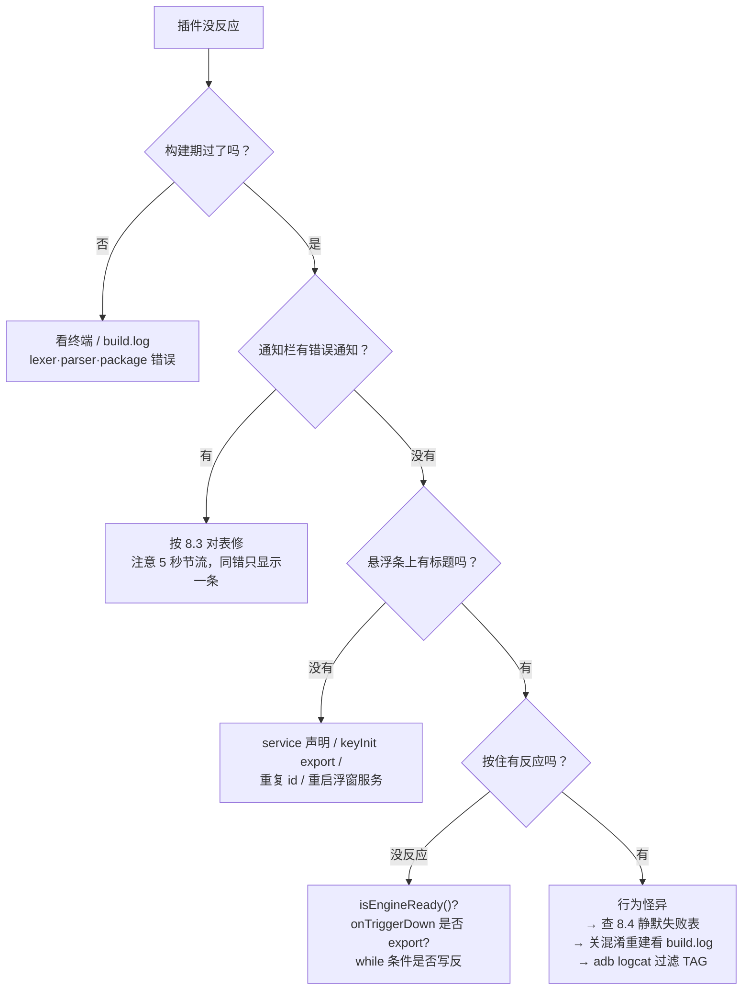

# 08 调试与错误处理

**本章目标**：脚本报错时知道去哪看、错误码什么意思、哪类错误是静默的。

**前置**：[03 DSL 语言快速上手](03-DSL语言快速上手.md) §3.9。专项排障：[10 §10.11](10-WS服务与游戏联动.md)、[11 §11.10](11-配置页与HostData.md)。

## 8.1 错误会去哪里

SDL 引擎和 Mio 桥的异常最终都会归拢到两层：

1. **日志**：`AppLogger`（标签 `DslPluginHandle` / `MioEngFunBridge` / `MioConfigBridge` / `DslEventDispatcher` 等）。
2. **系统通知**：插件函数调用抛 `SdlException` 时，宿主在通知栏发一条高优先级通知（渠道 `dsl_plugin_error`），内容格式：

```
<包名>.<函数名>
ErrorCode(码值,中文描述) | 异常message
```

> 同时会节流：同一「包名.函数名」的错误 5 秒内只刷一条，避免脚本循环报错把通知栏刷爆（`DslPluginHandle.ERROR_NOTIFY_THROTTLE_MS`）。

**关键事实**：`SdlException` 在服务循环里被捕获后**线程继续跑**（`DslPluginHandle.java:616-623`，`sleep(100)` 后下一轮）——报错 ≠ 插件死掉，但也意味着**同一个错会每 100ms 重复一次**（被 5 秒节流挡住通知，日志仍刷）。所以看到通知栏一条错，先修掉再测别的。

### 构建期 vs 运行期

| 阶段 | 错误表现 | 去哪看 |
|---|---|---|
| 构建期（`dsl-cli build`） | `BUILD FAILED` + `lexer/parser FAILED` | 终端输出、`build/build.log` |
| 运行期（装上后） | 通知栏 + AppLogger | 见 8.1；`adb logcat` 过滤对应 TAG |

构建期拦得住的（语法、package 不符、缺参签名在解析层可查的）不会带到运行期。

---

## 8.2 SdlException 错误码总表

所有宿主桥/引擎错误都是 `SdlException`，携带 `ErrorCode` 枚举：

| 码 | 枚举 | 中文描述 | 常见场景 |
|---|---|---|---|
| 0 | `UNKNOWN` | 未知错误 | 兜底 |
| 1 | `NOT_INITIALIZED` | 库未初始化 | Mio 未完成 `SdlEngine.init` |
| 2 | `INVALID_ARGUMENT` | 参数无效 | Mio 桥缺参 / 类型错 / 未知按键名 / 未知触发模式 |
| 3 | `INSTALL_FAILED` | 插件安装失败 | ZIP 损坏 / 目录异常 |
| 4 | `VERIFY_FAILED` | 插件签名校验失败 | 未签名或密钥不符 |
| 5 | `UNINSTALL_FAILED` | 插件卸载失败 | 卸载异常 |
| 6 | `PLUGIN_NOT_FOUND` | 插件不存在 | `宿主可调用函数不存在（需 EXPORT）` 之外「模块中不存在可调用函数」 |
| 7 | `PLUGIN_NOT_LOADED` | 插件尚未加载 | 未 open 就 call |
| 8 | `PLUGIN_ALREADY_LOADED` | 插件已在运行 | 重复 open |
| 9 | `BRIDGE_NOT_FOUND` | 桥接函数未注册 | 调用了未注册的 `命名空间.函数` |
| 10 | `BRIDGE_EXECUTION_FAILED` | 桥接函数执行失败 | 宿主实现抛非 SdlException |
| 11 | `PERMISSION_DENIED` | 权限被拒绝 | 未授权就调用需要权限的桥 |
| 12 | `REGISTRY_ERROR` | 持久化存储读写失败 | 配置读写异常 |
| 13 | `INTERNAL_ERROR` | 内部错误 | ✳️ 见下方「宿主可调用函数不存在」 |
| 14 | `UNSUPPORTED` | 功能尚未实现 | 预留能力 |
| 15 | `PLUGIN_TAMPERED` | 插件数据遭篡改 | 运行期安全校验失败 |
| 16 | `PLUGIN_DECRYPT_FAILED` | 插件脚本解密失败 | 加密脚本损坏 |
| 17 | `PLUGIN_LEGACY_FORMAT` | 插件为旧版未加密格式 | 安全策略禁止运行，重装 |
| 18 | `PLUGIN_ERROR` | 插件脚本执行抛出未捕获异常 | `call` 捕获到的脚本内部错误 |

## 8.3 常见错误消息对照

| 你会在通知里看到 | 实际含义 | 处理 |
|---|---|---|
| `宿主可调用函数不存在（需 EXPORT）: xxx`（`INTERNAL_ERROR`） | 调用了未导出的函数 | 目标函数需要 `export`；或这就是**可选入口**（见 8.4） |
| `模块中不存在可调用函数`（`PLUGIN_NOT_FOUND`） | 跨模块调用时目标模块无此函数 | 检查 `import` 与包路径 |
| `桥接函数未注册: MioEngFun.xxx`（`BRIDGE_NOT_FOUND`） | 宿主根本没注册这个桥 | 升级 Mio / 核对 [04 章](04-模块API速查.md) 签名 |
| `MioEngFun.tap: 未知按键名 KEYCODE_X`（`INVALID_ARGUMENT`） | 按键名拼写/大小写不对 | 对 [06 章](06-注入与按键码.md) 总表 |
| `MioEngFun.onKeyInit: 未知触发模式 xxx` | 第三参 model 写错 | 只允许 `BUTTON/SWITCH/PRESSURE_PLATE` |
| `MioEngFun.onKeyInit: 卡片背景必须以 @res/ 开头: xxx`（logcat 警告） | 第 8 参 `bgRes` 引用写法错 | 只接受 `@res/…`；两张背景（常态/按下）用 `\|` 分隔：`"@res/a.9.png\|@res/b.9.png"`（[04 §1.1](04-模块API速查.md)） |
| `MioEngFun.onKeyInit: 资源文件不存在: …`（logcat 警告） | `res/` 文件没进包或安装后没落地 | 文件放工程 `res/` 下重新构建；**已装插件需重新安装**才会补抽 `res/*`（[02 §2.5](02-插件包与运行环境.md)），该键回落默认背景 |
| `…: 缺少第 n 个参数` / `…必须为整数` | 实参与签名不符 | 按 [04 章](04-模块API速查.md) 传参 |
| `package '…' 与目录路径不符` | 构建期：首行 package ≠ 目录 | [03 §3.1](03-DSL语言快速上手.md) 对表改 |
| 构建期 `[FAIL] lexer FAILED` + build.log 只有 `parse_<文件> 失败: 解析错误数: 1`（**无位置细节**） | 两类元凶：① 文件开头有 **BOM**（UTF-8 带 BOM，实测带 BOM 必挂、去 BOM 即过）；② 写了词法不认的符号（如三元 `?:`，见 [03 §3.5](03-DSL语言快速上手.md)） | ① 用「UTF-8 无 BOM」重存该 `.dsl`；② 对 03 的语法表改写 |
| `MioConfig.onXxx: 必须在插件 config 模块的 schema() 中调用` | 配置声明写在了 `loading`/`keyInit`/其他模块 | 移进 `config.dsl` 的 `schema()`（[11](11-配置页与HostData.md)） |
| `MioConfig.onText: 未知 inputType xxx` | inputType 拼错 | 只允许 `""/int/decimal/digits/english` |
| `…key/title 不能为空…`（`INVALID_ARGUMENT`） | `MioConfig.onXxx` 必填参数为空串 | 每项给非空 `key`（全插件唯一）与 `title` |
| `保存失败：…不能小于/大于…`（Toast，非通知） | 配置页 `onText` int/decimal 越界 | 调整输入或放宽 min/max（[11 §11.5](11-配置页与HostData.md)） |
| `ws service loop dsl error: …`（日志） | WS 事件回调里抛错 | 看具体 message；线程不中断（[10](10-WS服务与游戏联动.md)） |
| `HostData.get → BRIDGE_EXECUTION_FAILED` + 异常链含 `NegativeArraySizeException` / `BufferUnderflowException` / `MagicMismatch` | 插件 `HostData.regbin` 存储文件损坏（panda save 曾缺 fsync，掉电可撕裂文件） | **AAR 已根治**（panda 拒载抛 `FileCorruptedException` + 引擎 `hostStore` 自动隔离重建）；宿主 `HostDataRepair` 作为二道防线再兜一层（日志 TAG `HostDataRepair`，备份 `HostData*.corrupt-<时间戳>`）；反复出现需查设备存储/断电时机 |

---

## 8.4 静默失败：不报错的坑

这些**不会给你任何错误提示**，排障时优先怀疑：

| 静默情形 | 后果 | 确认方法 |
|---|---|---|
| 可选入口（`onTriggerUp`、模型专属 6 个、`serverInit` 后的 `on<事件>`）没导出或**名字拼错** | 宿主 `callIfExported` 直接跳过 | 逐个核对函数名拼写（[09 §C](09-附录.md)） |
| `res/config.json` 忘了声明 `CONFIG` | `schema()` 永不执行，配置页是空的 | 对 [11 §11.2](11-配置页与HostData.md) |
| 忘了声明 `WS_SERVICE` | `serverInit`/事件全不跑 | 对 [10 §10.2](10-WS服务与游戏联动.md) |
| `onKeyInit` / `MioConfig.onXxx` 返回 `false`（重复 id / 重复 key） | 新注册被拒，用的是旧的那条 | 查日志 `重复` / `duplicate` |
| `HostData.get` 没保存过 | 返回 `null`——不报错 | 代码里要写 `== null` 回落（[11 §11.6](11-配置页与HostData.md)） |
| 配置改完没点「保存」直接退出 | 值没落盘，重启后还是旧的 | — |
| 注入函数返回 `false` 却不检查 | 空转浪费电 | 每次 `tap` 检查返回值 |
| `sendCommand` 拿不到响应 | 它只返回 requestId，**无响应回调** | 需要回包时改用事件通道（[10 §10.6](10-WS服务与游戏联动.md)） |

> 判定关键串：宿主用异常消息是否包含 `宿主可调用函数不存在` 来判断"未导出"。因此平常别在业务里手动 `throw` 相似文案。

## 8.5 常见陷阱清单

1. **Map 用 `.get`？不存在。** 用 `obj.key` / `obj["key"]`。
2. **没有默认参数。** Mio 桥对缺参会抛「缺少第 n 个参数」（只有**尾部**参数可省，按 null 传）。
3. **整数除法是整除。** 需要小数时让任一侧是 `Float`。
4. **`onTriggerDown` 里提前 `return` ≠ 正常结束。** 宿主只在"确实松开"后才发 `onTriggerUp` 和模型专属松开；提前 return 就算一直按住也会被服务循环再唤醒一次，注意别重复副作用（[05 §5.5](05-事件系统与触发模型.md)）。
5. **别在回调里依赖 UI 线程。** 所有插件函数跑在服务线程，`MioEngFun.showToast` / `MioFloating.*` 才会代你切主线程；lambda 回调在宿主线程执行。
6. **BUILD 后重启浮窗服务。** 重装插件后要触发 `loadDslPlugins` 才会重新 `open`。
7. **同一 id 重复注册返回 false。** `onKeyInit` 打印日志并经 `dsl_duplicate_id` 渠道发一次通知；id 全插件唯一。
8. **阻塞调用要有出口。** `sleep` / `tap` 是阻塞的，写循环时给 `while` 加 `isTriggerDown` 作为退出条件，否则服务线程无法停止（禁用/保存配置都卡住）。
9. **字符串内容比较别用 `==`。** 用 `System.stringEquals(a, b)`。
10. **字符串里别写 `\"` 转义。** DSL 词法不支持转义序列，会直接 `lexer FAILED`。
11. **`package` 必须等于目录路径。** 根目录文件（`main.dsl`/`config.dsl`）不写 `package`。
12. **同一服务内入口串行。** 一个长阻塞会饿死该服务的后续事件（WS 事件、下一触发）——见 [01 §1.4](01-总览与原理.md)。

## 8.6 快速排障流程



日志过滤建议：

```
adb logcat -s DslPluginHandle MioEngFunBridge MioConfigBridge DslEventDispatcher WsBridge
```

---

## 8.7 实战演练：三个典型错误的完整走读

### 案例一：`package` 写错（构建期拦下）

**现象**：`dsl-cli build` 在 `package` 任务失败，输出含

```
package 'mio.utils' 与目录路径不符
```

**走读**：文件在 `mio/shortcutKey/` 下，首行却写 `package mio.utils` → 编译器按 [03 §3.1](03-DSL语言快速上手.md) 规则拒绝。**这类错误装不到手机上**，看终端即可。
**修**：改成 `package mio.shortcutKey`（= 目录路径，不含文件名）。

### 案例二：循环里注入失败，通知栏狂刷

**现象**：通知栏一条 `io.xxx.plugin.onTriggerDown` / `INVALID_ARGUMENT(2,参数无效) | MioEngFun.tap: 未知按键名 KEYCODE_q`，5 秒只更新但日志刷屏。

**走读**：

1. 通知格式 = `包名.函数名` + `码值中文描述 | 异常消息`（§8.1）→ 定位到 `onTriggerDown`。
2. 消息里直接给了键名 `KEYCODE_q`——**小写**，[06 §6.2](06-注入与按键码.md) 表里是 `KEYCODE_Q`。
3. 为什么一直刷？脚本在 `while` 里每 25ms 调一次 `tap` → 每次抛错 → 服务循环捕获 → `sleep(100)` 后再来（§8.1 关键事实）；通知被 5 秒节流按住。
4. 错误发生在**注入函数**而非参数检查——如果键名来自配置/拼接，还要查 [08 §8.4](08-调试与错误处理.md) 的静默项（配置读回 `null` 落到空串）。

**修**：改拼写；动态键名先 `isKeyValid(name)` 守卫（[04 §1.6 ⑤](04-模块API速查.md)）。

### 案例三：配置页一项都看不到（无任何报错）

**现象**：点「编辑配置」弹的是正常面板但**空白**，通知栏干净，日志无 `MioConfigBridge` 输出。

**走读**（按 §8.4 静默表逐项排）：

1. `config.json` 有没有 `{ "name": "config", "tag": "CONFIG" }`？没有 → 宿主根本不调 `schema()`。
2. `config.dsl` 的 `schema()` 是否 `export`？没有 → 调不到（这个会报「需 EXPORT」，若连报错都没有说明走到第 1 步就停了）。
3. `schema()` 是否在 `loading`/`keyInit` 里被调？→ 会报「必须在 config 模块的 schema() 中调用」（有通知）。
4. 什么都没报 = 大概率是第 1 步。**这类"零报错"问题优先查声明**。

**修**：补 `CONFIG` 声明，重装并重启悬浮窗服务。

---

## 8.8 实体键触发模式（独立复制插件）

**场景**：把现有插件复制一份做「实体键触发」变体——外接键盘按键直接驱动 `onTriggerDown` 宏，**悬浮面板不出现任何卡片**（= 不调 `onKeyInit`、不注册面板快捷键），功能脚本零改动。参考实现：`Desktop\开发\Plugin-Physical`（`CuO • 实体键`，包名 `io.cuo.plugin.physical`）。

### 注册方式（功能 `keyInit` 内，替换原 `onKeyInit` 调用）

```java
private String ACTION_ID = "p_autoAttack"          // ① id 加 p_ 前缀（与原插件卡片 id 隔离）

export fn Void keyInit() {
    Object en = MioData.get("autoAttack.enabled")
    if(en == false) { return }                      // ② 关闭功能 = 不注册绑定
    String physicalKeyName = MioData.getString("autoAttack.physicalKey", "F6")   // ③ 配置键 <id>.physicalKey，空串=解绑
    MioEngFun.onPhysicalKeyInit(physicalKeyName, "SWITCH", ACTION_ID)             // ④ 绑定实体键
}
```

- 返回 `false`：键名非法（非 `A-Z0-9_`）、id 与卡片注册重复、`keyCode` 空（解绑）——通知栏**无**自动提示，排障见下文日志。
- 签名 `onPhysicalKeyInit(keyCode, triggerModel, id)`（[04 §1.1](04-模块API速查.md)）；包装在工程 `mio/utils/MioEngFun.dsl`。

### 约定

1. **id 加前缀**（`p_xxx`）：实体键绑定与卡片注册共用全局唯一 id 空间（`registeredShortcuts` + `physicalKeyById`），不加前缀会被原插件的 id 顶掉并触发重复 id 通知。
2. **不进面板 ≠ 不参与路由**：owner/包归属复用 `shortcutOwners`/`shortcutPackages` 全局表，`dispatchTriggerDown` 按注册包名过滤——两个插件声明同名 SHORTCUT_KEY 服务（复制插件常如此）也互不串扰。
3. **与卡片可并存**：同一 id 只能二选一；不同 id 可卡片 + 实体键混用，两者在 `ServiceThread` 里同线程串行。
4. **配置页**：每功能组内加一行 `MioConfig.onText("<id>.physicalKey", "<标题> · 触发键", "<说明>", "<默认键>", "默认 <键>", "", 0, 0)`——`inputType` 用 `""`（自由文本），保存重启插件生效。
5. **防回环**：Shizuku/IME 注入不经过内核 evdev，监听天然看不到注入；唯一回环源是虚拟手柄 uinput 设备，宿主 `MonitorDaemon.scanDevices` 按设备名黑名单（`Virtual`/`uinput`）排除，无需插件处理。
6. **实体键同时也会进游戏**：监听是只读的，不拦截——游戏内键位与绑定键冲突需自行规避（避开 MC 默认键）。

### 验收与排障

logcat 过滤 `InputMonitor|MonitorDaemon|DslEventDispatcher|MioEngFun`：

| 看什么 | 期望 |
|---|---|
| `MonitorDaemon … 排除虚拟输入设备` / `找到 N 个输入设备` | 设备扫描与黑名单生效 |
| `InputMonitorEngine state=RUNNING` | 监听已启动（FAILED=未授权 Shizuku 或开关未开，不自动重试） |
| `DslEventDispatcher dispatchPhysicalKey: key=F6 down=true boundIds=[p_autoAttack]` | 键到达并命中绑定；`boundIds=null` = 键名没注册（查 ③④ 与 `.enabled`） |
| `MioEngFunBridge onPhysicalKeyInit …` | 注册结果；`duplicate id` = 忘加前缀 |
| 悬浮面板 | 应**无**该功能卡片；配置页应有「触发键」行 |
| 小键盘键（`NUMPAD_*`） | 需 NumLock 开启才有 value 1 |

---

**上一步**：[07 从零写示例](07-从零写示例.md) · **继续**：[09 附录](09-附录.md)