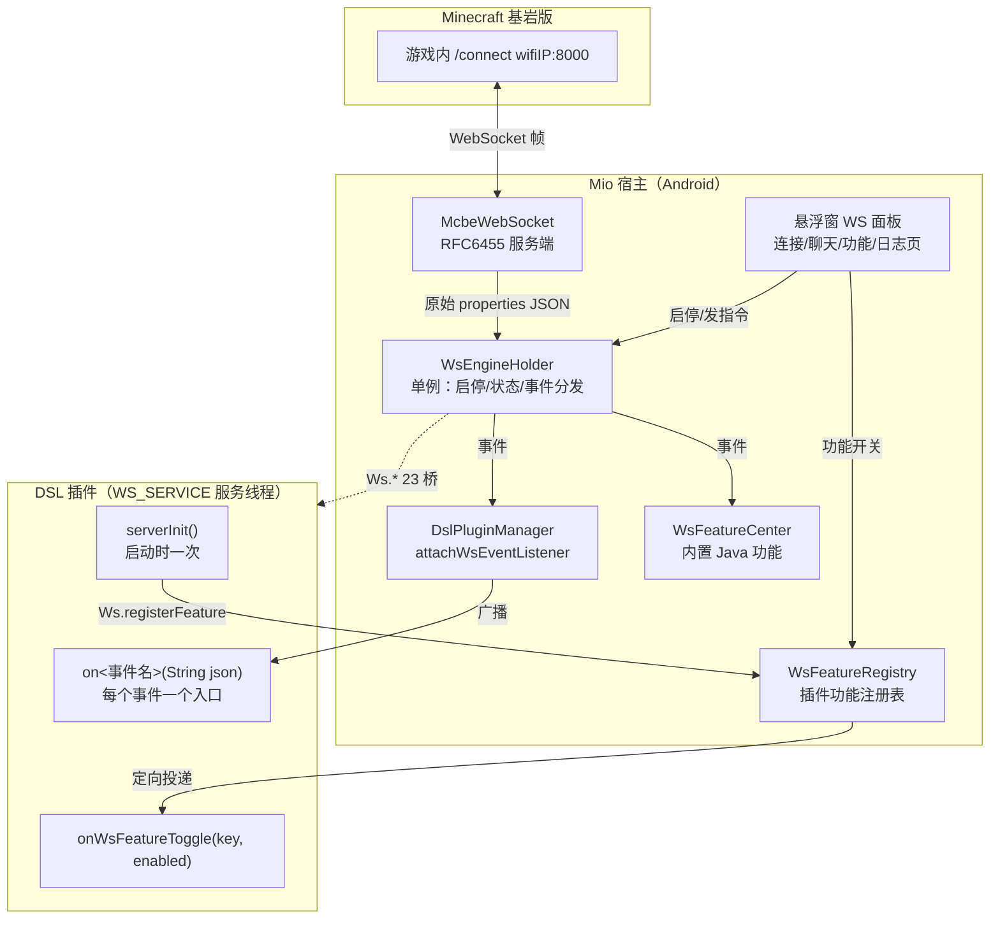
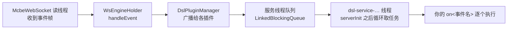
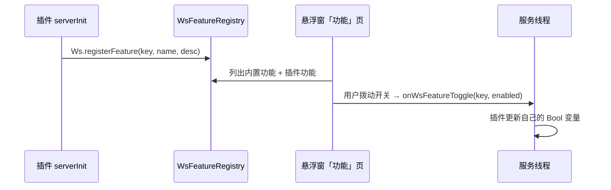

# 10 WS 服务与游戏联动

**本章目标**：让插件接入 Mio 的 MC WebSocket（基岩版 `/connect` 连接），接收游戏内事件、向游戏发指令/聊天，并提供「功能开关」给用户在悬浮窗里切换。

**前置**：[00 快速开始](00-快速开始.md)（知道 service 声明与入口函数）、[03 DSL 语法](03-DSL语言快速上手.md)。

**本章示例已通过 `dsl-cli build` 编译验证。**

---

## 10.1 架构总览



三层分工：

| 层 | 职责 |
|---|---|
| `McbeWebSocket` | 自实现 RFC6455 服务端（默认端口 **8000**），与游戏互发 JSON 帧 |
| `WsEngineHolder` | 单例状态机：启停、连接状态、玩家列表、事件收集并转发给监听者；**独立于面板生命周期**（面板关了引擎照跑） |
| DSL 插件 | 业务逻辑：收事件 → 判断 → 调 `Ws.*` 桥回写游戏 |

宿主连接成功后**自动订阅全部 29 种事件**（无需插件申请），并广播一条连接提示、查询在线玩家。

---

## 10.2 第一步：声明 `WS_SERVICE`

`res/config.json`：

```json
"service": [
  { "name": "main", "tag": "MAINSERVICE" },
  { "name": "mio.ws.autoReply", "tag": "WS_SERVICE" }
]
```

- `name` = 目录路径.文件名（`mio/ws/autoReply.dsl` → `mio.ws.autoReply`），规则同 [00 §0.3](00-快速开始.md)。
- 一个插件可以声明**多个** `WS_SERVICE`，各自独立线程、独立入口。
- 声明后，Mio 加载插件时自动为它启动一条服务线程（`dsl-service-<包名>.<服务名>`）。

---

## 10.3 三个入口函数（契约）

宿主只认这三个 `export` 入口；**未导出 = 静默跳过**（不报错、不通知）：

| 入口 | 签名 | 何时调用 | 必须导出？ |
|---|---|---|---|
| `serverInit` | `export fn Void serverInit()` | 服务线程启动时，**一次**，先于一切事件 | 注册功能才需要 |
| `on<事件名>` | `export fn Void onPlayerMessage(String json)` | 每个对应游戏事件到达时 | 只关心的事件才导出 |
| `onWsFeatureToggle` | `export fn Void onWsFeatureToggle(String key, Bool enabled)` | 用户在悬浮窗「功能」页切换你的开关 | 用了 `registerFeature` 才需要 |

要点：

- 事件入口名 = `"on" + 事件名`，**大小写敏感**：事件 `PlayerMessage` → 函数 `onPlayerMessage`；写成 `onplayermessage` 永远不会被调。
- 函数体在**服务线程**上串行执行（见 10.6），事件一个接一个处理，不会并发。
- 用 `callExported` 的候选顺序是 `<服务名>.<函数>` → `<叶名>.<函数>` → 裸函数名（[DslPluginHandle.java:213](../app/src/main/java/io/takamiya/mio/dsl/DslPluginHandle.java)），所以正常按包路径声明就无需关心。

---

## 10.4 事件：29 种全量清单与 JSON 结构

连接成功后宿主自动 `subscribe` 以下事件（`WsEngineHolder.ALL_EVENTS`，[WsEngineHolder.java:44](../app/src/main/java/io/takamiya/mio/ws/WsEngineHolder.java)）：

| 分类 | 事件名（= 入口函数去掉 `on`） |
|---|---|
| 玩家 | `PlayerMessage` `PlayerJoin` `PlayerLeave` `PlayerTravelled` `PlayerTransform` `PlayerTeleported` `PlayerDied` `PlayerBounced` |
| 方块 | `BlockPlaced` `BlockBroken` |
| 物品 | `ItemDropped` `ItemUsed` `ItemSmelted` `ItemAcquired` `ItemCrafted` `ItemDestroyed` `ItemEnchanted` `PotionBrewed` |
| 世界 | `MobKilled` `EndOfDay` `PortalBuilt` `PortalUsed` `VehicleExited` `UploadSkin` `AwardAchievement` `CauldronUsed` `JukeboxUsed` `CraftingSessionCompleted` `EntitySpawned` |

宿主把游戏发来的事件 `body` 里的字段**平铺**为一个 JSON 文本传给你（实测基岩版事件字段直接放 `body` 根下；`properties` 缺失时回退整个 `body`，见 [McbeWebSocket.java:1847](../app/src/main/java/io/takamiya/mio/ws/McbeWebSocket.java)）。

`PlayerMessage` 的权威样例（取自宿主内置功能的注释，[TestCommand.java:16](../app/src/main/java/io/takamiya/mio/ws/feature/TestCommand.java)）：

```json
{"message":"qaa","receiver":"","sender":"AIR114514CH","type":"chat"}
```

### 解析：`dsl.Json` 包装（5 个函数）

```java
import dsl.Json

export fn Void onPlayerMessage(String json) {
    String sender  = Json.jsonString(json, "sender")    // 字符串；不存在返回 ""
    String type    = Json.jsonString(json, "type")      // "chat" / 其他
    String message = Json.jsonString(json, "message")
    Int    x       = Json.jsonInt(json, "x")            // 整数；不存在返回 0
    Bool   on      = Json.jsonBool(json, "someBool")    // 布尔；不存在返回 false
    Object obj     = Json.parseJson(json)               // 一般用上面的 get* 即可
    [String] arr   = Json.jsonStringArray(json, "keys") // 字符串数组；不存在返回 []
}
```

- 点路径可下钻嵌套：`Json.jsonString(json, "block.coordinate.x")`。
- 各函数对应宿主桥 `Json.parse / getString / getInt / getBool / getStringArray`（`MioBridgeRegistry.java:120-124`），签名见 `dsl/Json.dsl` 包装文件。
- 字符串比较用 `System.stringEquals(a, b)`（`dsl.System`），**不要**假设 `==` 对字符串做内容比较。

> **重要**：不要在事件回调里长时间阻塞。下一个事件要等你 `return` 后才会执行（串行队列）。

---

## 10.5 `Ws.*`：23 个宿主桥

两种调用方式，任选：

```java
// ① 推荐：用插件侧包装模块 mio.ws.MioWs（签名与下表一致）
import mio.ws.MioWs
MioWs.sendTell(sender, "你好")

// ② 直接调宿主桥（写包装模块或一次性调用时）
private fn Bool wsTell(String p, String t) = call("Ws.sendTell")
```

> 本项目包装文件为 `src/script/mio/ws/MioWs.dsl`，已与宿主桥逐一对齐（`playSound` 参数顺序为 **音效名在前**）。

### 状态查询

| 桥 | 包装（MioWs） | 返回 | 说明 |
|---|---|---|---|
| `Ws.isRunning` | `isWsRunning()` | `Bool` | 服务端是否在监听 |
| `Ws.isConnected` | `isWsConnected()` | `Bool` | 是否已与游戏建立连接 |
| `Ws.getPort` | `wsPort()` | `Int` | 当前/已保存端口（默认 **8000**） |
| `Ws.getConnectCommand` | `wsConnectCommand()` | `String` | `/connect wifiIP:端口`（未启动时按配置端口给预览） |
| `Ws.getPlayerNames` | `wsPlayerNames()` | `String` | 在线玩家名文本（逗号分隔），未连接为 `null` |
| `Ws.getPlayers` | `wsPlayers()` | `[String]` | 在线玩家列表，未连接为空列表 |

### 启停

| 桥 | 包装 | 返回 | 说明 |
|---|---|---|---|
| `Ws.start` | `wsStart()` | `Bool` | 用当前保存端口启动（异步生效） |
| `Ws.startWithPort` | `wsStartWithPort(Int port)` | `Bool` | 指定端口启动并记住该端口 |
| `Ws.stop` | `wsStop()` | `Bool` | 停止服务 |

- 启停都投递到**主线程**执行，返回 `true` 只表示「请求已提交」；用 `isWsRunning()` 确认结果。
- 端口改了会自动重开（先停旧端口实例）。

### 指令与聊天

| 桥 | 包装 | 返回 | 未连接时 |
|---|---|---|---|
| `Ws.sendCommand` | `sendCommand(String cmd)` | `String` = requestId，失败 `null` | 返回 `null` |
| `Ws.sendChat` | `sendChat(String text)` | `Bool`（以服务端身份在公屏发言，等效聊天框回车） | 返回 `false` |
| `Ws.sendTell` | `sendTell(player, text)` | `Bool`（恒 `true`） | 静默忽略 |
| `Ws.sendToAll` | `sendToAll(text)` | `Bool`（等效 `sendTell("@a", text)`，即 `/tell @a`） | 静默忽略 |
| `Ws.sendTellraw` | `sendTellraw(player, jsonText)` | `Bool`（tellraw 到指定玩家） | 静默忽略 |
| `Ws.sendChatAs` | `sendChatAs(player, text)` | `Bool`（模拟该玩家发言） | 静默忽略 |
| `Ws.sendMe` | `sendMe(text)` | `Bool`（`/me` 动作消息） | 静默忽略 |

`sendCommand` 是后台执行游戏指令（`/` 开头走控制台指令语义），帧结构为标准 `commandRequest`：

```json
{"header":{"requestId":"<uuid>","messagePurpose":"commandRequest","version":1,"messageType":"commandRequest"},
 "body":{"origin":{"type":"player"},"commandLine":"/time set day","version":1}}
```

> **能力边界**：插件拿不到指令的**执行结果**（响应只进面板的 LiveData，没有 DSL 回调）；需要结果时改用能从事件侧观察效果的方案，或用 `sendTell` 让玩家看到反馈。

### 展示类

| 桥 | 包装 | 说明 |
|---|---|---|
| `Ws.sendTitle` | `sendTitle(player, title, subtitle)` | 标题；`subtitle` 可空；`player` 可为 `@a` |
| `Ws.sendActionbar` | `sendActionbar(player, text)` | 动作栏 |
| `Ws.sendTitleTimes` | `sendTitleTimes(player, fadeIn, stay, fadeOut)` | 时长（tick） |
| `Ws.clearTitle` | `clearTitle(player)` | 清除标题 |
| `Ws.playSound` | `playSound(sound, target, volume, pitch)` | **参数顺序：音效名 → 目标 → 音量[0-1] → 音调[0.5-2]** |
| `Ws.stopSound` | `stopSound(target, sound)` | 停止音效 |

展示类全部是「未连接静默忽略」，返回 `Bool` 恒为 `true`（发起了调用），**不代表游戏已显示**。

### 功能注册

| 桥 | 包装 | 说明 |
|---|---|---|
| `Ws.registerFeature` | `registerFeature(key, name, desc)` | **必须在 `serverInit` 内调用**，否则抛 `INVALID_ARGUMENT` |

```java
export fn Void serverInit() {
    MioWs.registerFeature("autoReply", "聊天自动回复", "玩家聊天发 hi 时自动回复")
}
```

- `key` **全局唯一**（宿主一张注册表管所有插件），同名后注册覆盖；用 `你的插件名.xxx` 前缀防撞。
- 归属（包名/服务名）由宿主从 `serverInit` 的线程上下文自动捕获——这也是必须在 `serverInit` 里调用的原因。
- 插件服务停止/关闭时，宿主自动注销它的全部功能条目。

---

## 10.6 线程模型



- 每个 `WS_SERVICE` 一条线程，**启动时先跑 `serverInit`（注册功能），随后进入取任务循环**（500ms 轮询，[DslPluginHandle.java:521](../app/src/main/java/io/takamiya/mio/dsl/DslPluginHandle.java)）。
- 事件在**入队时**就检查「该服务是否导出了对应入口」，没导出直接丢弃（`enqueueWsEvent`）。
- 事件队列是无界的：积压时先执行 `serverInit`/旧事件，实时性要求极高的逻辑要自己控制（回调里别睡觉太久）。
- 你的回调里可以放心调 `Ws.*`（宿主各发送函数标注任意线程安全）；但 `Ws.start/stop` 内部会切主线程。

---

## 10.7 功能开关闭环（registerFeature → onWsFeatureToggle）



- 「功能」页合并展示**内置 · xxx**（宿主 Java 功能）与插件注册项（[WsFeatureFragment.java:65](../app/src/main/java/io/takamiya/mio/floating/wss/WsFeatureFragment.java)）；内置项拨动走 `WsFeatureCenter`，插件项按 `key` 定向投递回**注册它的那个服务**——别的插件收不到。
- **开关状态不持久化**：功能条目只活在内存中（插件重载后要重新 `registerFeature`），开关值也只存在于你插件自己的变量里，重载即回到初始值。
- 想要持久化开关，用配置页：`CONFIG` + `MioConfig.onSwitch`（宿主持久化并自动重启插件，见 [11 配置页与HostData](11-配置页与HostData.md)），在 `serverInit` 里 `HostData.get` 读回初值，两套机制可组合：

```java
private fn Object readCfg(String key) = call("HostData.get")

private Bool replyOn = false

export fn Void serverInit() {
    MioWs.registerFeature("autoReply", "聊天自动回复", "玩家聊天发 hi 时自动回复")
    Object saved = readCfg("autoReply.enabled")   // 配置页保存过则回读
    if(saved == true) {
        replyOn = true
    }
}

export fn Void onWsFeatureToggle(String key, Bool enabled) {
    if(System.stringEquals(key, "autoReply")) {
        replyOn = enabled                          // 会话内即时生效
    }
}
```

> `HostData` 只有 `get`（插件只读）；写入只能由用户在配置页点「保存」完成。

---

## 10.8 启停、连接与验证

1. **启动服务端**：用户在悬浮窗 WS 面板启动，或插件在 `serverInit` 里调 `MioWs.wsStart()`。
2. **游戏内连接**：游戏聊天输入 `MioWs.wsConnectCommand()` 的输出（`/connect 192.168.x.x:8000`，IP 为手机 WiFi IP）。
3. **连接成功**：宿主自动订阅 29 事件 → 广播连接提示 → `testfor @a` 查询玩家列表。之后事件源源不断推给插件。
4. **断线**：发送类全部静默失效（`sendCommand` 返回 `null`）；插件可在回调里先 `if(!MioWs.isWsConnected()) return`（如 10.10 示例）。

验证清单：

| 预期 | 检查 |
|---|---|
| 插件加载后「功能」页出现你注册的项 | `serverInit` 导出且调用了 `registerFeature`；`config.json` 的 `name` 与文件路径一致 |
| 拨开关回调触发 | 导出了 `onWsFeatureToggle` 且 `key` 与注册时完全一致 |
| 游戏聊天后插件有反应 | 导出了 `onPlayerMessage`（大小写正确）；WS 已连接 |
| 收不到事件但没报错 | 入口没 `export`、事件名拼错、或 WS 没连上（`isWsConnected()`） |

---

## 10.9 与快捷键、配置页联动

WS 服务不是孤岛——它和 [05 快捷键](05-事件系统与触发模型.md)、[11 配置页](11-配置页与HostData.md)共享同一个插件包。

### 三个联动点

| 联动 | 怎么做 | 线程安全依据 |
|---|---|---|
| WS 事件 → 触发快捷键侧反馈 | 回调里直接调 `MioEngFun.showToast` / `MioFloating.*` | 浮窗函数内部切主线程；`isTriggerDown` 读宿主全局状态表（`MioEngFunBridge.triggerStates`），跨服务读安全 |
| WS 事件 → 快捷键逻辑开关 | 用模块级 `Bool` 当标志；若快捷键与 WS 在**不同模块**，跨服务共享靠配置页（HostData）或宿主状态查询 | 模块级变量只在本模块线程内改；跨模块别直接共享变量 |
| 配置页 → WS 参数 | `serverInit` 里 `HostData.get` 读回关键词/端口等；保存配置会**重启插件 → serverInit 重跑** | [11 §11.7](11-配置页与HostData.md) 的保存即重启契约 |

### 已验证示例：配置驱动的回复关键词 + 服务启动提示

```java
package mio.ws

import mio.ws.MioWs
import dsl.System

private Bool replyOn = false
// 回复关键词：配置页可改，未保存时用默认值（模块变量必须写在函数之前）
private String keyword = "hi"

// 读取宿主已保存配置（与快捷键模块同一套 HostData）
private fn Object readCfg(String key) = call("HostData.get")

export fn Void serverInit() {
    // 配置驱动：开服务时读一次（保存配置 → 插件重启 → serverInit 重跑）
    Object k = readCfg("autoReply.keyword")
    if(k != null) {
        keyword = k
    }
    MioWs.registerFeature("autoReply", "聊天自动回复", "玩家聊天发关键词时自动回复")
}

// 事件 → 全局提示（WS 服务线程里调，showToast 自己切主线程）
export fn Void onServerStarted() {
    MioWs.sendChat("WS 服务已就绪")
}

export fn Void onPlayerMessage(String json) {
    if(!replyOn || !MioWs.isWsConnected()) {
        return
    }
    // …type/sender/message 解析见 10.10…
    // if(System.stringEquals(message, keyword)) { MioWs.sendTell(sender, "…") }
}
```

配套的配置声明（`config.dsl`）：

```java
MioConfig.onSection("WS")
MioConfig.onText("autoReply.keyword", "回复关键词", "收到该词时私聊回复", "hi", "默认 hi", "english", 0, 0)
```

要点：

- **端口也可配**：`Object p = readCfg("ws.port")` → `MioWs.wsStartWithPort(port)`（未配置用默认 8000）。
- **`keyword` 是模块级变量**——注意声明位置必须在第一个 `fn` 之前（[03 §3.9](03-DSL语言快速上手.md) 的 parser 规则）。
- WS 模块与快捷键模块**各自一条服务线程**：一个模块里的长阻塞不会卡另一个模块，但会卡本模块的后续事件（[01 §1.4](01-总览与原理.md)）。

---

## 10.10 完整示例：聊天自动回复机器人

`res/config.json` 增加：

```json
{ "name": "mio.ws.autoReply", "tag": "WS_SERVICE" }
```

`src/script/mio/ws/autoReply.dsl`（**已通过 `dsl-cli build` 验证**）：

```java
package mio.ws

import mio.ws.MioWs
import dsl.Json
import dsl.System

// 聊天自动回复机器人：收到聊天消息后按关键词回复
private Bool replyOn = false

// 服务启动入口（必导出）：注册一个 WS 功能开关
export fn Void serverInit() {
    MioWs.registerFeature("autoReply", "聊天自动回复", "玩家聊天发 hi 时自动回复")
}

// 功能开关闭环：悬浮窗「功能」页切换开关时回调
export fn Void onWsFeatureToggle(String key, Bool enabled) {
    if(System.stringEquals(key, "autoReply")) {
        replyOn = enabled
    }
}

// 游戏事件入口：事件名 PlayerMessage → 导出 onPlayerMessage
// 参数为宿主转发的原始 properties JSON（字段平铺）
export fn Void onPlayerMessage(String json) {
    if(!replyOn) {
        return
    }
    if(!MioWs.isWsConnected()) {
        return
    }
    String type = Json.jsonString(json, "type")
    if(!System.stringEquals(type, "chat")) {
        return
    }
    String sender = Json.jsonString(json, "sender")
    String message = Json.jsonString(json, "message")
    if(System.stringEquals(message, "hi")) {
        MioWs.sendTell(sender, "你好 " + sender + "，我是 Mio 自动回复")
    }
}
```

逐段说明：

- **三层门卫**（开关 → 连接 → 消息类型）是事件回调的推荐结构：能不处理就尽早 `return`，减少队列延迟。
- `serverInit` 只注册不干活；真正的业务全在 `onPlayerMessage`。
- 回复用 `sendTell`（私聊），换成 `MioWs.sendChat(...)` 即公屏、`MioWs.sendToAll(...)` 即全体。

### 进阶：执行指令并把结果告诉玩家

```java
// 玩家发 "$time" 时给全体设为白天（借鉴宿主内置 WSCommand 的玩法）
if(System.stringEquals(message, "$time")) {
    String req = MioWs.sendCommand("time set day")
    if(req == null) {
        MioWs.sendTell(sender, "指令失败：WS 未连接")
    } else {
        MioWs.sendToAll("白天已到来")
    }
}
```

---

## 10.11 能力边界与排障

**做不到的事（避免踩坑）**：

| 期望 | 实情 |
|---|---|
| 发送原始 WebSocket 帧 | 无此桥；只能用 `Ws.*` 封装的指令/消息类发送 |
| 收到连接/断开生命周期回调 | 无 DSL 入口；轮询 `isWsConnected()`，或用内置功能的思路写 Java `WsFeature`（宿主侧） |
| 拿到 `sendCommand` 的执行结果 | 响应只进面板 LiveData，无 DSL 回调 |
| 收到 `ALL_EVENTS` 之外的事件 | 订阅清单固定 29 种，插件不能动态 `subscribe` |
| 保存功能开关（重载后保留） | 注册表与开关值均不持久化；改用配置页开关（10.7） |

**错误对照**：

| 现象/日志 | 原因与处理 |
|---|---|
| `registerFeature 必须在 WS_SERVICE 服务的 serverInit 中调用` | 把它移进 `serverInit`（归属靠线程上下文捕获） |
| 功能页没有你的条目 | `serverInit` 未导出、`config.json` 未声明 `WS_SERVICE`、或 `name` ≠ 目录.文件名 |
| 事件回调从不触发 | 检查导出名 `on` + 事件名精确匹配、WS 是否已连接 |
| `onText: 未知 inputType` 之类配置报错 | 见 [11](11-配置页与HostData.md) 与 [08 调试与错误处理](08-调试与错误处理.md) |
| 事件有延迟 | 回调里 `sleep` 过久；事件在同一队列串行执行 |

宿主日志关键字：`WsBridge`、`WsEngineHolder`、`WsFeatureRegistry`、`dsl-service-`；面板有专门的 WS 日志页。

---

**下一章**：[11 配置页与HostData](11-配置页与HostData.md)——给插件（含 WS 插件）做一个可持久化的设置界面。
