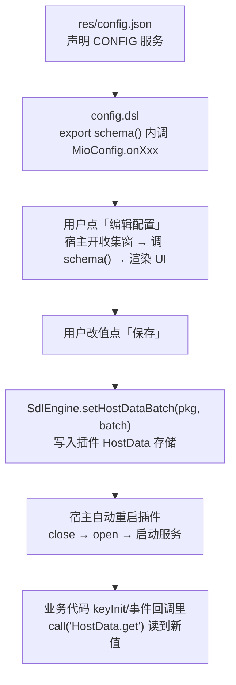

# 11 配置页与 HostData

**本章目标**：给插件做一个可持久化的设置界面——用户改配置 → 点保存 → 宿主落盘并自动重启插件 → 插件代码读回新值。

**前置**：[00 快速开始](00-快速开始.md)（`CONFIG` 声明）、[03 DSL 语法](03-DSL语言快速上手.md)。

**本章示例已通过 `dsl-cli build` 编译验证。**

---

## 11.1 端到端闭环



四个角色：

| 角色 | 在哪 | 干什么 |
|---|---|---|
| 声明 | `res/config.json` | `{"name":"config","tag":"CONFIG"}`——不声明 = 没有配置页 |
| 定义 | `src/script/config.dsl` 的 `schema()` | 一行一项描述 UI 长什么样 |
| 存储 | 引擎 `HostData`（插件私有） | 保存的 key→值；插件**只读**（`HostData.get`） |
| 读取 | 你的业务模块 | `import mio.utils.MioData` → `MioData.get(key)`（= `call("HostData.get")`，带默认值用 `MioData.getInt(key, def)` 等） |

> **没有 `CONFIG` 声明会怎样**：宿主不调 `schema()`/`values()`，用户点「编辑配置」只弹一个「该插件无配置页」提示——不会产生「函数不存在」错误。所以不需要配置页的插件**不必**写 `config.dsl`。

---

## 11.2 声明 CONFIG

`res/config.json`：

```json
"service": [
  { "name": "main",   "tag": "MAINSERVICE" },
  { "name": "config", "tag": "CONFIG" }
]
```

- `name` 用配置模块的**叶文件名**（`src/script/config.dsl` → `"config"`；带包时取最后一段，宿主按叶名调 `schema`/`values`/`onButton`，见 `PluginConfigDeclaration.configModule`）。
- 模块放在 `src/script/config.dsl`（根目录、无 `package`）是最简单可靠的写法。

---

## 11.3 `schema()`：一行一项

`src/script/config.dsl` 全控件示例（**已通过 `dsl-cli build` 验证**）：

```java
import mio.utils.MioConfig

// 配置页：覆盖全部控件类型；一行一项，key 全插件唯一
export fn Void schema() {
    MioConfig.onSection("基本")
    MioConfig.onSwitch("demo.enabled", "启用功能", "关闭并保存后快捷键不再注册", true)
    MioConfig.onCheckbox("demo.notice", "触发时提示", "", false)
    MioConfig.onText("demo.msg", "提示文字", "弹出的 toast 内容", "触发了！", "", "", 0, 0)
    MioConfig.onText("demo.holdMs", "按住时长（毫秒）", "整数并限定范围", "115", "默认 115", "int", 1, 1000)
    MioConfig.onText("demo.ratio", "倍率", "支持小数", "1.5", "", "decimal", 0, 10)

    MioConfig.onSection("选择")
    MioConfig.onRadio("demo.key", "注入按键", "", ["KEYCODE_Q", "KEYCODE_J", "KEYCODE_V"], "KEYCODE_Q")
    MioConfig.onChip("demo.extra", "附加动作", "", ["提示音", "悬浮提示"], ["提示音"])

    MioConfig.onSection("只读与动作")
    MioConfig.onTextView("demo.about", "关于", "", "本示例演示全部控件类型")
    MioConfig.onProgress("demo.level", "等级", "不可持久化的展示项", 30, 100, "30%")
    MioConfig.onButton("demo.reset", "恢复默认", "点击后回调 onButton 并收到本 key", "重置")
}

// 按钮回调：key 来自 onButton 第一参；本函数必须 export
export fn Void onButton(String key) {
    return
}
```

规则速记：

- **`schema()` 必须 `export`**，且只在配置页被打开/解析时调用（宿主开「收集窗」→ 调 `schema` → 关窗）。
- 在 `schema()` **之外**调用任何 `MioConfig.onXxx` 会抛 `INVALID_ARGUMENT`：`必须在插件 config 模块的 schema() 中调用`（`loading`/`keyInit` 里调也不行）。
- **key 必填、全插件唯一**：重复 key 该行被忽略并写警告日志（返回 `false`）；`title` 空串抛错。
- **一行写不下分组就 `onSection`**：新开顶部 Tab 分组；第一项之前不调 `onSection` 则落入默认分组「配置」。`onSection` 本身不计入配置项数。
- **尾部参数可省略**（缺参按 null 传递）：如 `onSwitch(k, t, s, true)` 后两参、`onText` 的 hint/inputType/min/max。

### 9 个声明函数签名（宿主桥，权威）

包装模块：`src/script/mio/utils/MioConfig.dsl`；桥注册于 `MioBridgeRegistry.java:157-167`，实现于 `MioConfigBridge.java`。

```java
Bool onSection(String title)                                            // 新分组
Bool onSwitch(String key, String title, String subtitle, Bool value)     // 开关
Bool onCheckbox(String key, String title, String subtitle, Bool value)   // 复选框
Bool onText(String key, String title, String subtitle,
            String value, String hint, String inputType,
            Int min, Int max)                                            // 文本输入
Bool onRadio(String key, String title, String subtitle,
             [String] options, String value)                             // 单选
Bool onChip(String key, String title, String subtitle,
            [String] options, [String] selected)                         // 多选
Bool onProgress(String key, String title, String subtitle,
                Int value, Int max, String text)                         // 进度环
Bool onTextView(String key, String title, String subtitle, String body)  // 只读文本
Bool onButton(String key, String title, String subtitle, String label)   // 按钮
```

- 返回 `Bool`：`true` 登记成功；`false` 仅因 **key 重复**被忽略（看日志 `重复的 key=…，已忽略`）。
- `onRadio` 的 `value` 是**默认选中的那个选项**（须存在于 `options`），`onChip` 的 `selected` 是默认选中列表——都可省略。
- `options` 支持 `[String]` 字面量，也接受逗号分隔字符串（宿主 `strings()` 兼容解析）。

---

## 11.4 控件总表

| 控件 | 函数 | 保存值类型 | 保存进 HostData | 说明 |
|---|---|---|---|---|
| 开关 | `onSwitch` | `Bool` | ✅ | 最常用：功能总开关 |
| 复选框 | `onCheckbox` | `Bool` | ✅ | 同上，样式不同 |
| 文本 | `onText` | 见 inputType | ✅ | 唯一可自由输入的类型 |
| 单选 | `onRadio` | `String`（选中项） | ✅ | |
| 多选 | `onChip` | `String`（**逗号拼接**） | ✅ | 读回后自行 `String.split`（`dsl.System.stringSplit`） |
| 进度环 | `onProgress` | — | ❌ | 纯展示；保存时跳过 |
| 只读文本 | `onTextView` | — | ❌ | 纯展示；保存时跳过 |
| 按钮 | `onButton` | — | ❌ | 点击回调 `onButton(key)`，保存时跳过 |
| 分组 | `onSection` | — | ❌ | 只是 Tab 标题 |

### `inputType` 与 min/max（仅 `onText`）

| inputType | 保存值 | 输入过滤 | min/max |
|---|---|---|---|
| `""`（或省略） | `String` | 任意 | 忽略 |
| `"int"` | `Int` | 整数键盘 | 生效，**越界保存时报错**（`不能小于/大于`） |
| `"decimal"` | `Double` | 小数键盘 | 生效（按数值比较） |
| `"digits"` | `String` | 仅数字 | 忽略 |
| `"english"` | `String` | 仅英文 | 忽略 |

- 取值之外的 inputType（如 `"text"`）**立即抛错**：`onText: 未知 inputType text（可选 int/decimal/digits/english）`。
- 数值型 `onText` 的 `value` 是**字符串字面量**（`"115"`）；保存时宿主解析成 `Int`/`Double` 再落盘，读回时是数值类型。

---

## 11.5 校验矩阵：抛错 vs 静默 vs 跳过

| 情况 | 行为 | 用户可见 |
|---|---|---|
| `schema()` 之外调 `MioConfig.onXxx` | 抛 `INVALID_ARGUMENT` | 通知栏 DSL 错误 + 日志 |
| `key` 或 `title` 为空串 | 抛 `INVALID_ARGUMENT` | 同上 |
| `inputType` 非法 / `onRadio`/`onChip` options 为空 | 抛 `INVALID_ARGUMENT` | 同上 |
| `onText` int 值越界（保存时） | 保存中断 | Toast「保存失败：…不能小于 X」 |
| **key 重复** | 返回 `false`，该行被忽略 | 无提示，仅日志警告 |
| 未声明 `CONFIG` | 不调 `schema` | 「编辑配置」→「无配置页」提示 |
| `count==0`（schema 什么都没登记） | 回退解析旧式返回值；仍空则无配置页 | 无错误 |

---

## 11.6 插件读配置：`MioData.get`（= `HostData.get`）

> **推荐写法**：`import mio.utils.MioData` 后直接读——
> `MioData.get(key)` 取原值（未保存 → `null`）；`MioData.getOr/getBool/getInt/getDouble/getString(key, def)` 带默认值（未保存或 `null` 时返回 `def`，免去回落样板）。
> 本节示例沿用 `readCfg` 手写转发写法，讲解的是同一底层机制（`call("HostData.get")`），两种写法完全等价。

保存后宿主把值写进插件的 HostData 存储（与引擎 `HostData.get` 同一实例），业务代码这样读（真实工程 `autoAttack.dsl` 的写法）：

```java
// 读取宿主已保存配置（HostData 存储，未保存时为 null）
private fn Object readCfg(String key) = call("HostData.get")
```

### 三种典型消费模式

**① 数值（带默认回落）**

```java
Int holdMs = 115                       // schema 里的默认值
Object h = readCfg("demo.holdMs")
if(h != null) {
    holdMs = h                         // 已保存则覆盖
}
```

**② 布尔开关（决定要不要注册/执行）**

```java
// keyInit 里：用户关闭并保存后，插件重启时不再注册该快捷键
Object en = readCfg("demo.enabled")
if(en == false) {
    return
}
MioEngFun.onKeyInit("配置演示", "BUTTON", DEMO_ID, "点击后按配置注入按键", "工具")
```

**③ 字符串/枚举**

```java
String keyName = "KEYCODE_Q"
Object k = readCfg("demo.key")         // onRadio 保存的是选中项字符串
if(k != null) {
    keyName = k
}
```

### 消费端完整示例（`src/script/mio/shortcutKey/demo.dsl`，已验证）

```java
package mio.shortcutKey

import mio.utils.MioEngFun

private String DEMO_ID = "demo"

// 读取宿主已保存配置（HostData 存储，未保存时为 null）
private fn Object readCfg(String key) = call("HostData.get")

export fn Void keyInit() {
    // 开关配置：用户关闭并保存后，重启插件即不再注册本快捷键
    Object en = readCfg("demo.enabled")
    if(en == false) {
        return
    }
    MioEngFun.onKeyInit("配置演示", "BUTTON", DEMO_ID, "点击后按配置注入按键", "工具")
}

export fn Void onTriggerDown() {
    if(!MioEngFun.isTriggerDown(DEMO_ID)) {
        return
    }
    if(!MioEngFun.isEngineReady()) {
        MioEngFun.showToast("按键注入未就绪")
        return
    }

    // 数值配置：未保存时用默认值
    Int holdMs = 115
    Object h = readCfg("demo.holdMs")
    if(h != null) {
        holdMs = h
    }

    // 字符串配置
    String keyName = "KEYCODE_Q"
    Object k = readCfg("demo.key")
    if(k != null) {
        keyName = k
    }

    // 布尔配置
    Object n = readCfg("demo.notice")
    if(n == true) {
        MioEngFun.showToast("按住了 " + keyName)
    }

    while(MioEngFun.isTriggerDown(DEMO_ID)) {
        Bool ok = MioEngFun.tap(keyName, holdMs)
        if(!ok) {
            MioEngFun.showToast("按键注入失败，已停止")
            return
        }
        MioEngFun.sleep(25)
        if(MioEngFun.isTriggerUp(DEMO_ID)) {
            break
        }
    }
}
```

要点：

- `HostData.get` 返回 `Object`：未保存 → `null`；保存过 → `Bool`/`Int`/`Double`/`String`（类型由 11.4 的「保存值类型」决定）。**用 `== null` 判断，不要假设类型**。
- 插件**不能写** HostData（桥只有 `get`）；唯一写入途径 = 用户点配置页「保存」。
- `HostData.get` 可在任意模块、任意时机调用（不限于配置模块）。

---

## 11.7 保存即重启：生效时机契约

用户点「保存」后宿主依次：`setHostDataBatch` 落盘 → Toast「已保存，插件即将重启生效」→ `reloadDslPlugin`（**关闭插件 → 重新打开并启动所有服务**，`PluginConfigActivity.saveConfiguration` → `FloatingWindowService.reloadDslPlugin`）。

因此：

| 配置用途 | 生效方式 | 需要额外代码？ |
|---|---|---|
| 决定注册哪些快捷键 | 重启后 `keyInit` 重新执行，读到新值 | ❌ |
| 循环里的参数（时长/间隔） | 重启后各回调读到新值 | ❌ |
| 运行中要立刻改 | **做不到**——下次保存才生效 | 设计上接受重启 |
| 按钮 `onButton(key)` | 点击立即回调（不经保存） | ✅ 需 `export` |

- 重启期间插件服务线程全部停掉再起，WS 服务的 `serverInit` 也会重跑（[10 §10.7](10-WS服务与游戏联动.md) 的功能注册会重新登记）。
- 插件被**禁用**时配置页照常可编辑可保存（宿主检测到引擎句柄失效会自动重开句柄）；启用后首次加载即读到已保存值。

**用户视角五步**（排障时按这个顺序复现）：

1. 悬浮窗 → 插件卡片 → 「编辑配置」→ 宿主**打开收集窗并调用一次 `schema()`**（此刻读到的是上次保存的值）。
2. 用户改各项 → 实时校验（`inputType` 不符/越界即时提示，见 §11.5）。
3. 点「保存」→ 宿主校验通过 → `setHostDataBatch` 落盘 → Toast「已保存，插件即将重启生效」。
4. 宿主 `reloadDslPlugin`：关插件 → 重开 → 走一遍加载（`loading`/`keyInit`/`serverInit` 全部重新执行）。
5. 之后任何回调 `HostData.get(key)` 读到的都是新值。

三个常见误会：

| 误会 | 实情 |
|---|---|
| 「改完保存了，游戏里立刻变」 | 不会——**保存触发重启**，新值从重启后才生效 |
| 「面板里改了没保存，代码里先读到新的」 | 不会——`HostData.get` 只读已落盘数据，预览值不落库 |
| 「保存后回调没读到新值」 | 三查：key 拼写一致？`HostData.get` 返回 `Object`（数值要比较/转换）？是否在**重启前**的旧回调里读的（打印时机太早）？ |

---

## 11.8 `onButton` 与旧式兼容

### `onButton`

- `schema()` 里 `MioConfig.onButton(key, title, subtitle, label)` 登记按钮；用户点击 → 宿主调 `config 模块.onButton(key)`（`PluginConfigDeclaration.callButton`）。
- **必须 `export`**，否则点击无反应（按「函数不存在」处理）。
- 回调**立即执行**，与「保存」相互独立——适合「重置」「复制配置」「执行一次动作」这类不落盘的操作。
- 当前存储是只读的，按钮里改不了 HostData；典型实现是弹 Toast / 触发插件内动作。

### 旧式兼容（新插件不用写）

| 旧写法 | 现状 |
|---|---|
| `schema()` 返回嵌套 `List<Map>`（`category`/`items`/`type`…） | 兼容：`MioConfig` 收集为 0 项时宿主才回退解析返回值 |
| 导出 `values()` 返回 `Map` | 兼容：导出且非空则用它回显；否则宿主直读 HostData |

新插件遵循本章一行式 + 免 `values()` 即可（`config.dsl` 头注释就是这么写的）。

---

## 11.9 实战：多快捷键工程的配置页组织

单快捷键工程一个 Tab 就够；**几十个快捷键的工程怎么排？** 真实插件（105 行 `config.dsl`）的组织方式——**「全局 Tab + 每个快捷键一个 Tab」**，Tab 顺序与 `config.json` 的 `service[]` 顺序一致（`onSection` 的标题 = 对应 `keyInit` 的快捷键标题）：

```java
export fn Void schema() {
    // ── 全局 Tab：跨快捷键共享的参数 ──
    MioConfig.onSection("全局")
    MioConfig.onText("cmd.tapMs", "指令按键时长（毫秒）", "打开聊天框/回车发送的按键时长", "20", "默认 20", "int", 1, 500)
    MioConfig.onText("cmd.openMs", "打开聊天等待（毫秒）", "打开聊天框后到输入指令前的等待", "300", "默认 300", "int", 0, 5000)
    MioConfig.onText("cmd.sendMs", "发送等待（毫秒）", "输入指令后到回车发送前的等待", "200", "默认 200", "int", 0, 5000)

    // ── 每个快捷键一个 Tab：注册开关 + 该功能自己的参数 ──
    MioConfig.onSection("自动攻击")
    MioConfig.onSwitch("autoAttack.enabled", "注册快捷键", "关闭并保存后重启插件，该快捷键不再注册", true)
    MioConfig.onText("autoAttack.holdMs", "按住时长（毫秒）", "循环中每次按键按住时长", "25", "默认 25", "int", 1, 2000)
    MioConfig.onText("autoAttack.intervalMs", "按键间隔（毫秒）", "两次按键之间的等待时长", "5", "默认 5", "int", 0, 5000)

    MioConfig.onSection("自动射箭")
    MioConfig.onSwitch("autoBow.enabled", "注册快捷键", "关闭并保存后重启插件，该快捷键不再注册", true)
    MioConfig.onText("autoBow.holdMs", "按住时长（毫秒）", "循环中每次按键按住时长", "460", "默认 460", "int", 1, 2000)
    // …后面每个快捷键重复这个三件套…
}
```

### key 命名规范（真实工程约定）

```
<功能名>.<参数名>
cmd.tapMs / cmd.openMs            ← 全局（跨功能共享）
autoAttack.enabled / autoAttack.holdMs / autoAttack.intervalMs
autoBow.enabled / autoBow.holdMs
```

| 规则 | 原因 |
|---|---|
| `<功能>.enabled` **固定开头** | 每个快捷键的注册开关用同一后缀，业务侧 `keyInit` 里判断写法统一（§11.6 模式②） |
| 功能名 = 快捷键 id 前缀 | `autoAttack` 既是 id、又是 key 前缀，一眼对上 |
| 全局参数放独立前缀（如 `cmd.`） | 不与任何功能名冲突，且集中在一个 Tab |
| **全插件唯一** | 重复 key 后登记的那条被静默忽略（§11.5）——合并两个插件的配置时最容易踩 |
| 用 `.` 分层而非 `-`/`_` | 与宿主 scheme 的读取路径一致，也方便在代码里按前缀联想到功能 |

### 与「注册开关」配套的 `keyInit` 写法

```java
export fn Void keyInit() {
    Object en = readCfg("autoAttack.enabled")
    if(en == false) { return }   // 用户关掉 → 本次不注册（重启后生效）
    MioEngFun.onKeyInit("自动攻击", "SWITCH", "autoAttack", "…", "战斗")
}
```

这样「禁用某个功能」不需要删代码——用户在配置页关掉即可（[07 §7.7](07-从零写示例.md) 有完整链路）。

---

## 11.10 排障

| 现象 | 原因与处理 |
|---|---|
| 「编辑配置」提示无配置页 | `config.json` 没声明 `CONFIG`，或 `schema()` 未 `export` |
| 打开配置页通知栏报错 | 看错误消息：窗口外调用 / key·title 为空 / inputType 非法（11.5 表） |
| 某配置项保存后不生效 | 该类型不持久化（progress/textView/button）；或业务端没读（11.4 表） |
| 改了值读回还是旧的 | 保存后必须「保存」按钮落盘；改完直接返回不生效 |
| 保存时报「不能小于/大于」 | `onText` int/decimal 越界，min/max 拦截 |
| 同名配置项少了一个 | key 重复被忽略，查日志 `重复的 key=` |
| chip 读回是一整串 | 保存为逗号拼接字符串，用 `System.stringSplit(v, ",")` 拆 |

宿主日志关键字：`MioConfigBridge`、`PluginConfigDeclaration`、`PluginConfigActivity`。

---

**返回**：[00 快速开始](00-快速开始.md) 知识地图 · [04 模块API速查](04-模块API速查.md) §5 配置速查 · [10 WS服务与游戏联动](10-WS服务与游戏联动.md)
